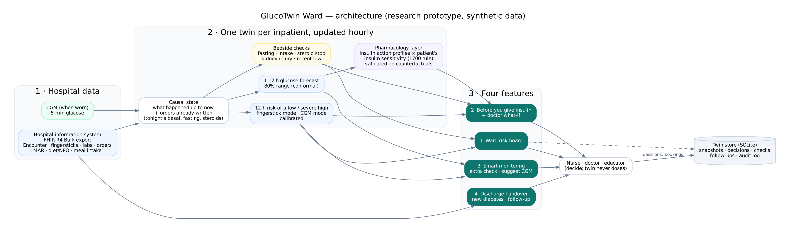
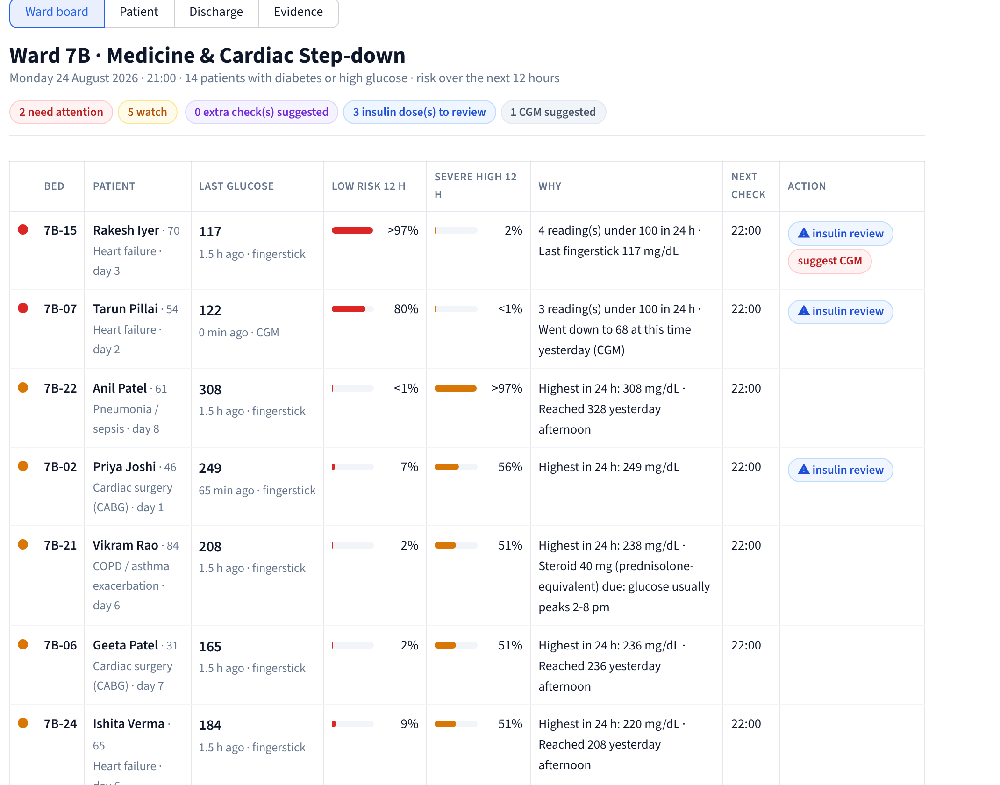
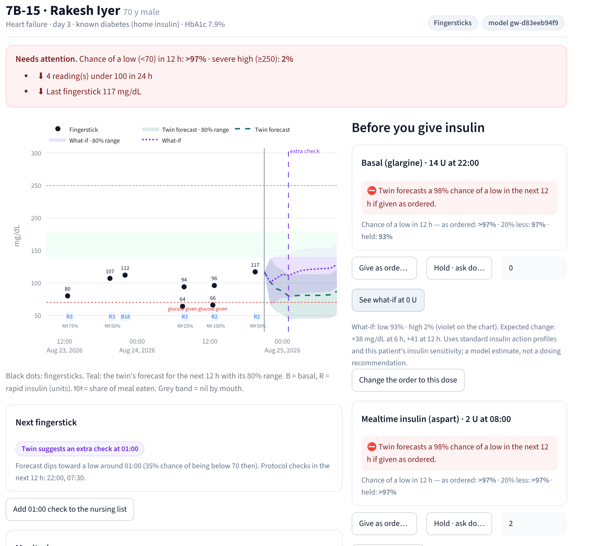
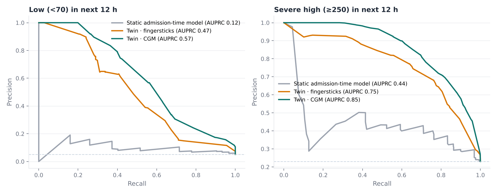
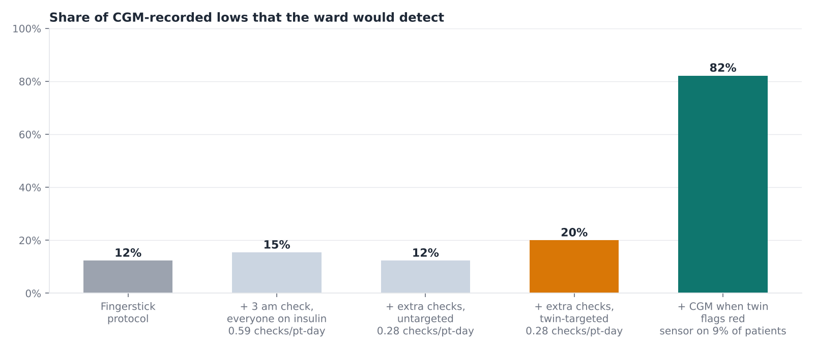

# GlucoTwin Ward

**A live glucose twin for every inpatient with diabetes: it warns the ward about lows before they happen, checks insulin before it is given, targets monitoring to the patients who need it, and hands over new diabetes at discharge.**

> Research prototype on **synthetic patients**. Not a medical device. The twin flags and forecasts for clinician review;
> it never recommends a dose.



---

## Team

| | |
|---|---|
| Team name | _GlucoTwin_ |
| Team leader | _Ritwik Sarkar_ |
| Members | _[Priya Manadal_ |
| College / incubator | Indian Institute of Management Lucknow |
| Challenge | Happiest Health — Digital Twin in Healthcare PoC Challenge, Phase 1 |

## Submission checklist

| Required item | Where |
|---|---|
| Team details and college/incubator | above |
| Project title | GlucoTwin Ward |
| Problem statement and healthcare use case | [§1](#1-the-problem) · [product brief](docs/product_brief.md) |
| Technical stack and AI/ML model details | [§5](#5-technical-stack), [§6](#6-how-the-twin-works) |
| Open-source licence | Apache-2.0 — [`LICENSE`](LICENSE) |
| Architecture diagram (PDF) | [`docs/architecture.pdf`](docs/architecture.pdf) |
| Presentation (PDF/PPT) | [`presentation/project_deck.pdf`](presentation/project_deck.pdf) · [`.pptx`](presentation/project_deck.pptx) |
| Live demo | _[Streamlit link]_ |

---

## 1. The problem

Roughly one in four inpatients has diabetes or high glucose. On general wards, glucose is managed with fingersticks four
times a day, paper sliding scales and one consultant round a day, and it goes wrong in predictable ways:

* **Lows happen between checks and harm patients.** In 54,502 admissions of people with diabetes, 18% had a moderate and
  2.8% a severe low, associated with longer stays, readmission and 90-day mortality (SHM Converge 2025).
* **Insulin errors are routine.** A 27-hospital audit found insulin errors in up to 39% of insulin-treated inpatients
  (Queensland Inpatient Diabetes Survey, MJA 2021).
* **Steroid highs are missed by design.** Morning steroids push glucose up in the afternoon and evening; wards check fasting glucose.
* **New diabetes is missed at discharge.** About a quarter of hyperglycaemic admissions in a 2026 Delhi study had undiagnosed diabetes.

Published hospital models predict once, at admission, retrospectively. Real-time CGM to the nursing station cut serious
lows in a randomised trial (Diabetes Care 2020) but is not approved for hospital use in most places. The one mature
insulin-dosing system is US-only. **Nobody gives an Indian ward a live, patient-level picture of the next 12 hours.**

## 2. The product: four features, one screen each

| # | Feature | For whom | What it does |
|---|---|---|---|
| 1 | **Ward risk board** | Nurse in charge | Every patient sorted by chance of a low or severe high in the next 12 h, with plain-language reasons from their own record. Red is reserved for lows. |
| 2 | **Before you give insulin** | Nurse, doctor | Bedside checks for every dose due (fasting, poor intake, steroid stopped, kidney injury, recent low) and the chance of a low if given, reduced or held. Doctors can try a dose and see the projected range. Never proposes a dose. |
| 3 | **Smart monitoring** | Nurse, diabetes team | Suggests an extra fingerstick at the riskiest hour for high-risk patients, and a CGM for the highest-risk ones. |
| 4 | **Discharge handover** | Discharging doctor | One page: glucose during the stay, lows, steroids, kidney changes, probable new diabetes (or a prompt to order HbA1c) and a follow-up to book. |

Deliberately left out: a chatbot, a patient app for inpatients, automatic dosing. The full PM view (users, metrics,
pilot plan, regulation, risks) is in the [product brief](docs/product_brief.md).

<p align="center"></p>
<p align="center"></p>

## 3. Results (held-out synthetic patients)

| | Result |
|---|---|
| **Board** — chance of a low in the next 12 h | AUPRC **0.47** on fingersticks (0.58 with CGM) vs **0.12** for a static admission-time model; 69% of lows flagged red a median 11 h before they start, 0.64 red hours per patient-day |
| **Insulin check** | **92%** (176/191) of injected unsafe situations flagged before the dose; high-level flag on 4.7% of routine doses |
| **Dose what-if** | Error vs the true counterfactual effect **6.1 mg/dL** (basal) and **5.4** (mealtime), half that of the learned model; holding basal: true +25 mg/dL at 6 h, twin +23, learned model +2 |
| **Smart monitoring** | Fingersticks catch 12% of CGM-recorded lows; twin-timed extra checks raise this to 20% (4.7 extra lows per 100 checks vs 0.9 for a 3 am check for everyone); **a CGM started at the twin's first red flag would have been on for 80% of lows while needed by 9% of patients** |
| **Discharge** | **91%** of undiagnosed diabetes identified or prompted for HbA1c, no false new diagnoses |

Details: [`evaluation/model_report.md`](evaluation/model_report.md) · raw: [`evaluation/metrics.json`](evaluation/metrics.json)

<p align="center"></p>
<p align="center"></p>

## 4. Quick start

```bash
git clone https://github.com/ritwiksarkar11/glucotwin.git && cd glucotwin
make install                  # Python 3.11+
make app                      # http://localhost:8501 — uses the shipped data and models
make all                      # optional: rebuild everything from scratch (~15 min on 2 cores)
uvicorn glucotwin.api:app     # REST API, docs at http://localhost:8000/docs
```

**Host a live demo (free):** at [share.streamlit.io](https://share.streamlit.io) choose *Create app → Deploy a public app
from GitHub*, pick this repository, branch `main`, main file `app/dashboard.py`, Python 3.12.

**Demo:** the app opens on Ward 7B at 21:00, before the bedtime insulin round. Click a name to open that patient's twin;
switch to *Doctor* to try a dose; use *+1 h* / *Shift* to move the ward clock.

## 5. Technical stack

| Layer | Choice |
|---|---|
| Data in | HL7 FHIR R4 Bulk Data export (NDJSON): Patient, Encounter, Condition, Observation (fingersticks LOINC 41653-7, HbA1c, creatinine), MedicationRequest, MedicationAdministration, NutritionOrder, NutritionIntake, Procedure; CGM CSV |
| Processing | Python 3.11+, pandas, NumPy, PyArrow |
| Models | LightGBM (binary with monotone constraints, Huber and quantile), scikit-learn isotonic calibration |
| Uncertainty | 80% forecast ranges: residual quantile models + split-conformal widening on calibration patients |
| Hybrid layer | Insulin pharmacology (textbook action profiles, 1700-rule sensitivity) validated on counterfactual simulations |
| Store | SQLite: ward snapshots, dose decisions, extra checks, follow-ups, audit log |
| Interfaces | Streamlit + Plotly ward app; FastAPI REST API |
| Delivery | Makefile, Dockerfile, GitHub Actions, pytest |

## 6. How the twin works

* **Synchronises every hour** from the hospital record: fingersticks, CGM where worn, insulin and steroids given, meals and
  how much was eaten, creatinine, HbA1c, and **orders already written** (tonight's basal, tomorrow's fasting, the steroid
  course). Nothing recorded after the update time is used (tested).
* **Predicts** the chance of a low and a severe high in the next 12 h (one model for fingerstick-only patients, one with
  CGM) and the glucose path 1-12 h ahead with an 80% range. Thresholds are set on calibration patients.
* **Explains** with the model's largest contributions turned into ward language from the patient's own data ("Fasting 8 h
  in the next 12 h with insulin scheduled", "Steroid course ended; insulin not yet reduced").
* **Simulates** dose changes with a pharmacology layer, because learned models cannot separate a dose's effect from the
  reason it was given.
* **Checks** every dose due against fixed bedside rules a nurse can verify.
* **Records** every flag, what-if, decision, extra check and booking with the model version.

## 7. Data

All synthetic. A ward simulator generates 800 admissions (sepsis, cardiac surgery, COPD/asthma, heart failure,
orthopaedics) with diabetes or in-hospital hyperglycaemia, including undiagnosed diabetes. It simulates physiology
(meals and intake, insulin, sulfonylureas, steroids, stress, kidney injury) and the ward process (fingerstick protocol,
sliding scale, daily titration round, fasting orders, hypoglycaemia protocol), with realistic process failures injected
at stated rates. It exports a FHIR R4 Bulk Data export, the only thing the twin reads. Every patient has independent random
streams, so any dose can be changed and the patient re-simulated: a true counterfactual. See the [data card](docs/data_card.md).

## 8. Repository

```
app/dashboard.py              ward app (board · patient twin · discharge · evidence)
src/glucotwin/
  sim/                        ward simulator + FHIR Bulk export
  ingest/fhir_bulk.py         FHIR NDJSON -> twin tables (the only data entry point)
  features/                   causal hourly features, CGM-labelled outcomes, patient-level split
  models/                     training, calibration, board thresholds, model bundle
  twin/                       engine (4 features), pharmacology layer, reasons & bedside rules, SQLite store
  evaluation/                 held-out evaluation, counterfactual what-if validation
  api.py                      REST API
data/synthetic/               FHIR export, CGM, cohort stats, hidden ground truth
models/                       trained models, thresholds, pharmacology scale
evaluation/                   metrics.json, model_report.md, figures/
docs/                         product brief, architecture, data card, limitations, video script
presentation/                 deck (.pptx, .pdf) and its build script
tests/                        simulator, causality, streaming = batch, rules, what-if, discharge
```

## 9. Safety, privacy, regulation

* Never recommends a dose; the doctor decides and the twin records the decision.
* Red is reserved for lows; highs show as "watch", to keep alerts meaningful.
* Data-quality messages on every patient (stale fingerstick, CGM signal lost); fingerstick-only mode by default.
* Synthetic data only, built to DPDP-by-design principles (purpose limitation, minimisation).
* Under CDSCO's medical device software guidance (July 2026), this would be clinician decision-support software; the
  pilot plan, change control and drift monitoring are in the [product brief](docs/product_brief.md).

Limitations: [`docs/limitations.md`](docs/limitations.md).

## 10. Sources

SHM Converge 2025, hypoglycaemia in 54,500 hospitalised patients · Queensland Inpatient Diabetes Survey, Med J Aust 2021 ·
Glucose Telemetry System RCT, Diabetes Care 2020 · Hospital hyperglycaemia study, J Assoc Physicians India 2026 ·
Glucocorticoid-induced hyperglycaemia, Medicine Today 2014 · CDSCO Guidance on Medical Device Software, 2026 ·
ADA Standards of Care, Diabetes Care in the Hospital · KDIGO acute kidney injury definition.

## Licence

Apache License 2.0 — see [`LICENSE`](LICENSE). The previous outpatient version is tagged `v0.1-outpatient`.
